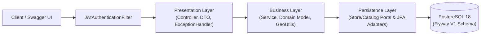
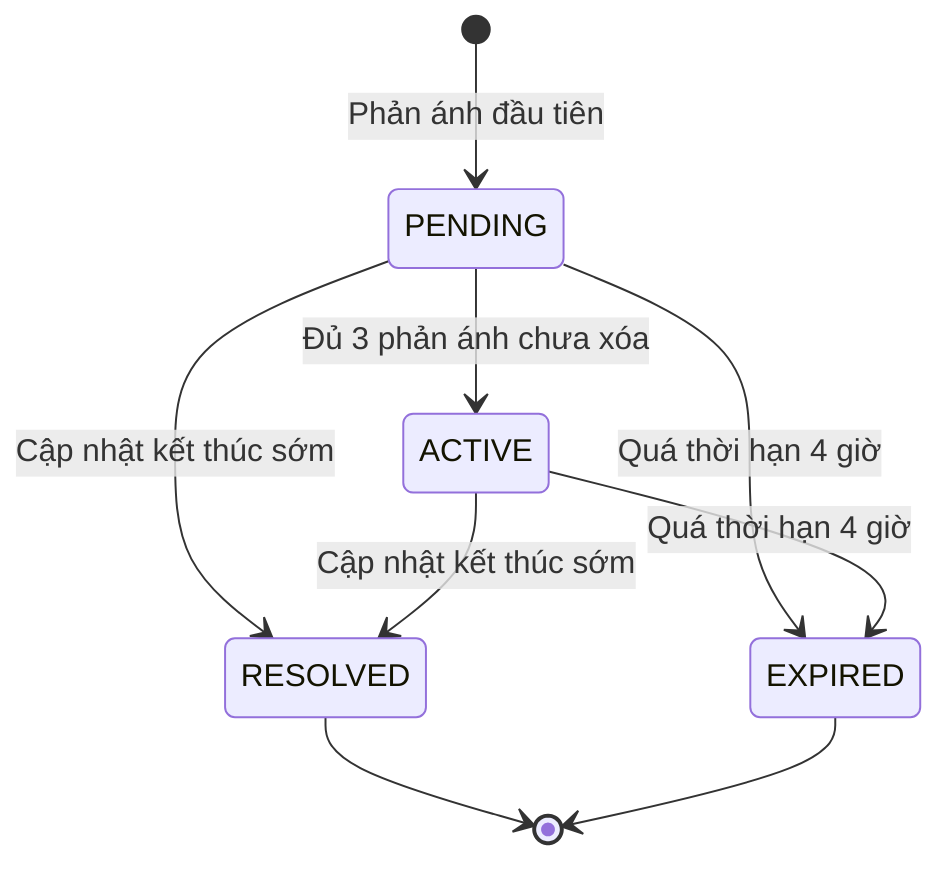
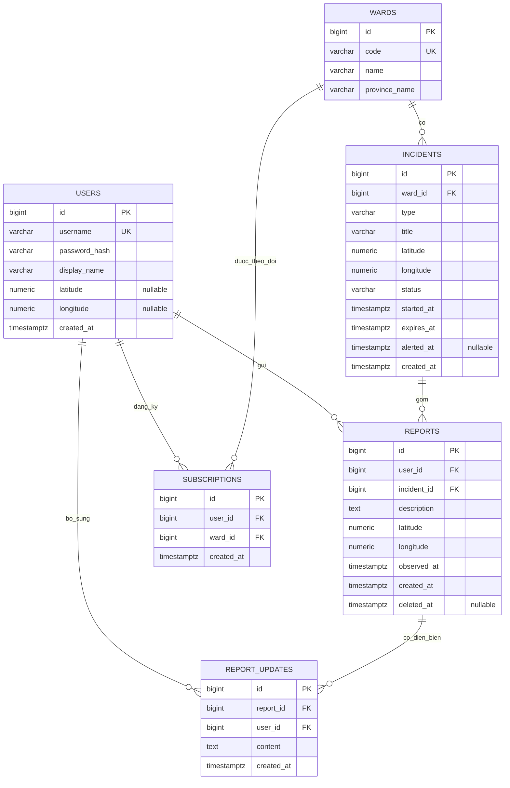

# Kiều Mai Notifier

Backend dịch vụ cảnh báo ngập lụt, ùn tắc giao thông và sự cố đô thị theo thời gian thực dựa trên phản ánh cộng đồng.

## Tài liệu chi tiết

- Đặc tả API đầy đủ (quét từ Springdoc OpenAPI 3.1.0): [docs/API-SPECIFICATION.md](docs/API-SPECIFICATION.md) (YAML: [docs/openapi.yaml](docs/openapi.yaml), JSON: [docs/openapi.json](docs/openapi.json)).
- Khởi tạo database và API theo schema mới: [docs/DATABASE.md](docs/DATABASE.md).
- Chi tiết nghiệp vụ module phản ánh (report): [docs/REPORT-MODULE.md](docs/REPORT-MODULE.md).
- Chi tiết nghiệp vụ module theo dõi phường và bảng tin (subscription & feed): [docs/NOTIFIER-MODULE.md](docs/NOTIFIER-MODULE.md).
- Hướng dẫn chạy backend và PostgreSQL bằng Docker Compose: [docs/DOCKER.md](docs/DOCKER.md).
- Hướng dẫn publish image lên GitHub Container Registry và chạy image đã build: [docs/GHCR.md](docs/GHCR.md).

---

## 1. Bài toán và mục tiêu

Khi mưa lớn hoặc giờ cao điểm, thông tin ngập lụt và ùn tắc trên mạng xã hội thường rời rạc, chậm trễ và thiếu kiểm chứng. **Kiều Mai Notifier** cung cấp REST API cho phép:

1. Người dùng gửi phản ánh (`report`) kèm tọa độ, thời điểm quan sát, phường và loại sự cố (`FLOOD`, `TRAFFIC_JAM`, `OTHER`).
2. Hệ thống tự động gom các phản ánh gần nhau trong cùng phường và cùng loại thành một điểm sự cố (`incident`).
3. Khi sự cố đạt đủ ngưỡng phản ánh tin cậy, trạng thái chuyển sang `ACTIVE` và xuất hiện trên bảng tin của những người dùng đang theo dõi phường đó.
4. Tự động hết hạn sự cố sau thời gian hiệu lực hoặc cho phép cập nhật kết thúc sớm khi sự cố đã được khắc phục.

---

## 2. Kiến trúc hệ thống

Ứng dụng được xây dựng bằng **Java 21** và **Spring Boot**, tuân thủ kiến trúc phân tầng 3 lớp tách biệt:



- **Presentation Layer (`com.kieumai.notifier.presentation`)**: Tiếp nhận HTTP request, kiểm tra dữ liệu đầu vào (`jakarta.validation`), ánh xạ giữa Request/Response DTO và Domain Model, chuẩn hóa phản hồi lỗi qua `ReportExceptionHandler` và `NotifierExceptionHandler`.
- **Business Layer (`com.kieumai.notifier.business`)**: Chứa các Domain Model (`Incident`, `Report`, `ReportPage`, `ActiveIncident`, `Subscription`, `Ward`, `User`) và logic nghiệp vụ (`ReportService`, `IncidentService`, `SubscriptionService`, `FeedService`, `WardService`, `IncidentScheduler`, `GeoUtils`). Tầng nghiệp vụ làm việc qua các interface port (`ReportStore`, `IncidentStore`, `SubscriptionRepository`, `ActiveIncidentRepository`, `WardCatalog`), không phụ thuộc trực tiếp vào JPA Entity hay thư viện truy vấn database.
- **Persistence Layer (`com.kieumai.notifier.persistence`)**: Triển khai các Adapter kết nối Spring Data JPA (`ReportStoreAdapter`, `IncidentStoreAdapter`, `SubscriptionRepositoryAdapter`, `ActiveIncidentRepositoryAdapter`, `WardCatalogAdapter`), quản lý ORM Entity và schema PostgreSQL bằng Flyway (`V1__create_notifier_schema.sql`).
- **Bảo mật tập trung (`com.kieumai.notifier.security` & `config`)**:
  - Mật khẩu được băm bằng `PasswordEncoder` (`{bcrypt}`).
  - Xác thực stateless JWT tập trung tại middleware `JwtAuthenticationFilter`.
  - Danh tính người gọi (`userId`, `username`) được trích xuất từ `SecurityContext`, chống giả mạo `userId` qua tham số request.
  - Mở công khai `/auth/register`, `/auth/login` và tài liệu OpenAPI/Swagger (`/swagger-ui/**`, `/v3/api-docs/**`).

---

## 3. Đặc tả nghiệp vụ chính

### 3.1. Vòng đời sự cố (`Incident`)



- **`PENDING`**: Sự cố mới được khởi tạo từ phản ánh đầu tiên, chưa đủ ngưỡng tin cậy nên chưa phát lên bảng tin `/me/feed`.
- **`ACTIVE`**: Sự cố đã có phản ánh hợp lệ (chưa xóa) từ **3 người dùng phân biệt** (`DISTINCT user_id`) trở lên, được hiển thị trong bảng tin của người theo dõi phường.
- **`RESOLVED` / `EXPIRED`**: Sự cố đã kết thúc sớm hoặc quá thời hạn mà không có phản ánh mới. Các sự cố ở trạng thái kết thúc không nhận thêm phản ánh mới và tự rời khỏi bảng tin.

### 3.2. Gom phản ánh và xử lý đồng thời (Multi-user Concurrency)

- **Quy tắc gom**: Khi người dùng tạo phản ánh mới tại `(wardId, type, latitude, longitude)`:
  1. Tìm các sự cố cùng `wardId`, cùng `type`, đang ở trạng thái hoạt động (`PENDING`, `ACTIVE`, `ALERTED`) và còn hạn (`expires_at > now`).
  2. Tính khoảng cách mặt cầu (Haversine trong `GeoUtils`) tới tâm sự cố (tọa độ phản ánh đầu tiên).
  3. Chọn sự cố gần nhất trong bán kính **1000 m** (nếu bằng nhau thì ưu tiên `id` nhỏ hơn), gắn phản ánh vào sự cố đó và gia hạn `expires_at` thêm **4 giờ** (`14400` giây).
  4. Nếu không có sự cố phù hợp, tạo sự cố mới ở trạng thái `PENDING` với thời hạn **4 giờ**.
- **An toàn đồng thời**:
  - `ReportService` và `IncidentService` khóa bi quan hàng phường (`SELECT ... FOR UPDATE` qua `WardRepository.findByIdForUpdate`) trong cùng transaction khi tạo/xóa phản ánh hoặc đóng sự cố, đảm bảo nhiều request gửi cùng lúc tại một khu vực không tạo ra các sự cố trùng lặp.
  - Bảng `subscriptions` có ràng buộc duy nhất `uk_subscriptions_user_ward (user_id, ward_id)` kết hợp xử lý ngoại lệ trả mã `409 ALREADY_SUBSCRIBED`.

### 3.3. Quyền sở hữu và xóa mềm phản ánh

- `DELETE /reports/{reportId}` thực hiện xóa mềm bằng cách ghi nhận `deleted_at`.
- Chỉ chủ sở hữu phản ánh mới có quyền xóa (`403 REPORT_NOT_OWNED` nếu xóa phản ánh của người khác).
- Phản ánh đã xóa không xuất hiện trong danh sách truy vấn và không được tính vào số lượng kích hoạt sự cố `PENDING`.

### 3.4. Theo dõi phường và bảng tin (`/me/feed`)

- Người dùng xem danh mục phường qua `GET /wards` (sắp xếp theo tên tỉnh và tên phường theo bảng chữ cái tiếng Việt) và đăng ký theo dõi qua `POST /me/subscriptions`.
- `GET /me/feed` truy vấn trực tiếp các sự cố đang `ACTIVE` thuộc tập phường người dùng theo dõi, sắp xếp sự cố mới nhất lên đầu.

---

## 4. Danh mục REST API

Tài liệu tương tác OpenAPI/Swagger có sẵn tại `http://localhost:8080/swagger-ui/index.html` khi chạy ứng dụng.

| Nhóm | Method | Đường dẫn | Mô tả | Xác thực |
| --- | --- | --- | --- | --- |
| Tài khoản | `POST` | `/auth/register` | Đăng ký tài khoản mới | Công khai |
| Tài khoản | `POST` | `/auth/login` | Đăng nhập, nhận JWT Bearer token | Công khai |
| Tài khoản | `GET` | `/me` | Lấy `userId` và `username` từ token hiện tại | JWT |
| Phường | `GET` | `/wards` | Danh sách phường (sắp xếp theo tỉnh, tên phường) | JWT |
| Phản ánh | `POST` | `/reports` | Gửi phản ánh mới và tự động gom vào sự cố | JWT |
| Phản ánh | `GET` | `/reports` | Lọc phản ánh theo `wardId`, `type`, `incidentId` (có phân trang) | JWT |
| Phản ánh | `GET` | `/me/reports` | Danh sách phản ánh của người dùng hiện tại | JWT |
| Phản ánh | `DELETE` | `/reports/{reportId}` | Xóa mềm phản ánh của chính mình | JWT |
| Diễn biến | `POST` | `/reports/{reportId}/updates` | Bổ sung diễn biến mới cho một phản ánh | JWT |
| Diễn biến | `GET` | `/reports/{reportId}/updates` | Xem lịch sử diễn biến của một phản ánh | JWT |
| Sự cố | `GET` | `/incidents` | Danh sách sự cố, lọc theo `wardId`, `type` | JWT |
| Sự cố | `GET` | `/incidents/{id}` | Chi tiết sự cố kèm `reportCount` | JWT |
| Sự cố | `POST` | `/incidents/{id}/updates` | Báo sự cố đã kết thúc sớm (`RESOLVED`) | JWT |
| Sự cố | `GET` | `/incidents/feed` | Lấy sự cố `ACTIVE` theo phường theo dõi hoặc quanh vị trí user | JWT |
| Theo dõi | `POST` | `/me/subscriptions` | Đăng ký theo dõi một phường (`{"wardId": ...}`) | JWT |
| Theo dõi | `GET` | `/me/subscriptions` | Danh sách các phường đang theo dõi | JWT |
| Theo dõi | `DELETE` | `/me/subscriptions/{wardId}` | Hủy theo dõi phường | JWT |
| Bảng tin | `GET` | `/me/feed` | Danh sách sự cố `ACTIVE` tại các phường đang theo dõi | JWT |

---

## 5. Sơ đồ cơ sở dữ liệu (PostgreSQL)



---

## 6. Chạy ứng dụng và kiểm thử

### Chạy bằng Docker Compose
Xem chi tiết tại [docs/DOCKER.md](docs/DOCKER.md):
```powershell
Copy-Item .env.example .env
# Chỉnh POSTGRES_PASSWORD và JWT_SECRET (tối thiểu 32 ký tự) trong .env
docker compose up -d --build
```

### Chạy bộ kiểm thử tự động
```powershell
.\mvnw.cmd test -B -ntp
```
