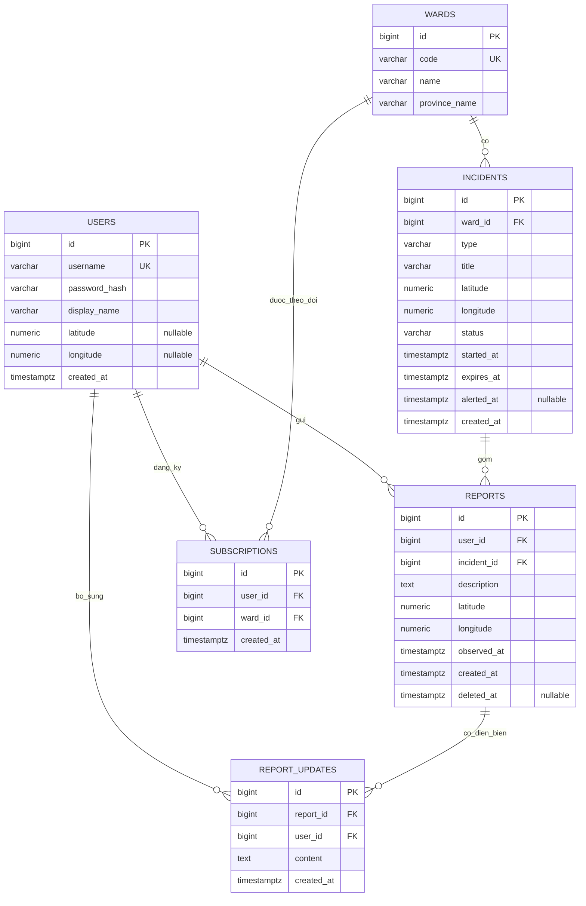

Hướng dẫn chạy backend và PostgreSQL bằng Docker Compose: [docs/DOCKER.md](docs/DOCKER.md).

Hướng dẫn publish image lên GitHub Container Registry và chạy image đã build: [docs/GHCR.md](docs/GHCR.md).

